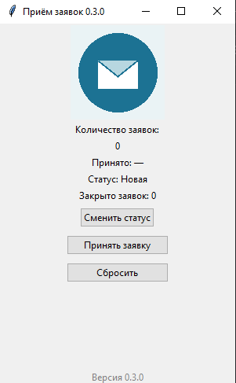

# Исходные данные программы Приём заявок

## Что открыть

Откройте прилагаемую Программа_приёма_заявок в VS Code. Прочитайте README.md, ТРЕБОВАНИЯ.txt, ЗАПРОС_ЗАКАЗЧИКА.txt и УСЛОВИЯ_ЗАДАНИЯ.txt. Запустите исходный app.py.

## Название и исходная версия

Программа приёма заявок 0.3.0

## Файлы и запуск

app.py

logo.png

Ввести терминал комманду

python Программа_приёма_заявок\\app.py

## Что видите сразу после запуска

## Проверочные действия 

| Версия   | Исходное состояние | Последовательность и число нажатий | Что увидели                            |
| -------------- | ----------------------------------- | ----------------------------------------------------------------- | ------------------------------------------------ |
| 0.3.0          | 0                                   | 10                                                                | Отсвутствие лимита заявок |
| 0.3.0          | 1, в работе                  | Сброс                                                        | Статус не сбрасывается       |
| [версия] | [начало или сброс]    | [действия]                                                | [реальный факт]                      |

## Требование и расхождение
| № | Приложение | Требования                                                                         |
| -- | -------------------- | ------------------------------------------------------------------------------------------ |
| 1  | да                 | Кнопка «Принять заявку» увеличивает счётчик на 1. |
| 2  | нет                 |Лимит 10 заявок: на 10-й надпись «Лимит: 10», кнопка «Принять заявку» блокируется. |
| 3  | да                 |Кнопка «Сбросить» обнуляет счётчик и дату, кнопка «Принять заявку» снова работает. |
| 4  | да                 |Кнопка «Сменить статус» меняет статус по кругу: Новая -> В работе -> Готово -> Новая. |
| 5  | да                 |После приёма заявки показывается дата в формате ДД.ММ.ГГГГ ЧЧ:ММ|
| 6  | да                 |Надписи и заголовок окна без опечаток. |
| 7  | да                 |Кнопки крупные, текст читается. |
| 8  | да                 |Программа закрывается без ошибок. |

## Цель версии 0.3.1
|№| Требование|
|--|------------------------------------------------------|
|1| При переходе статуса в «Готово» счётчик «Закрыто заявок» увеличивается на 1. В этой простой учебной модели считаются переходы в статус, а не уникальные заявки в списке.|
|2| «Сбросить» возвращает количество к 0, дату к «Принято: —», статус к «Новая» и «Закрыто заявок» к 0. Приём снова доступен.|
|3| В исправленной сборке в заголовке и нижней подписи указана версия 0.3.1|
|4| Программа запускается, когда app.py и logo.png лежат рядом, в том числе при запуске из другой рабочей папки|

## Что не входит в программу

В версии 0.3.0 отсутствует сброс статуса 

## Участники и источник оценок

Текалин Артём
